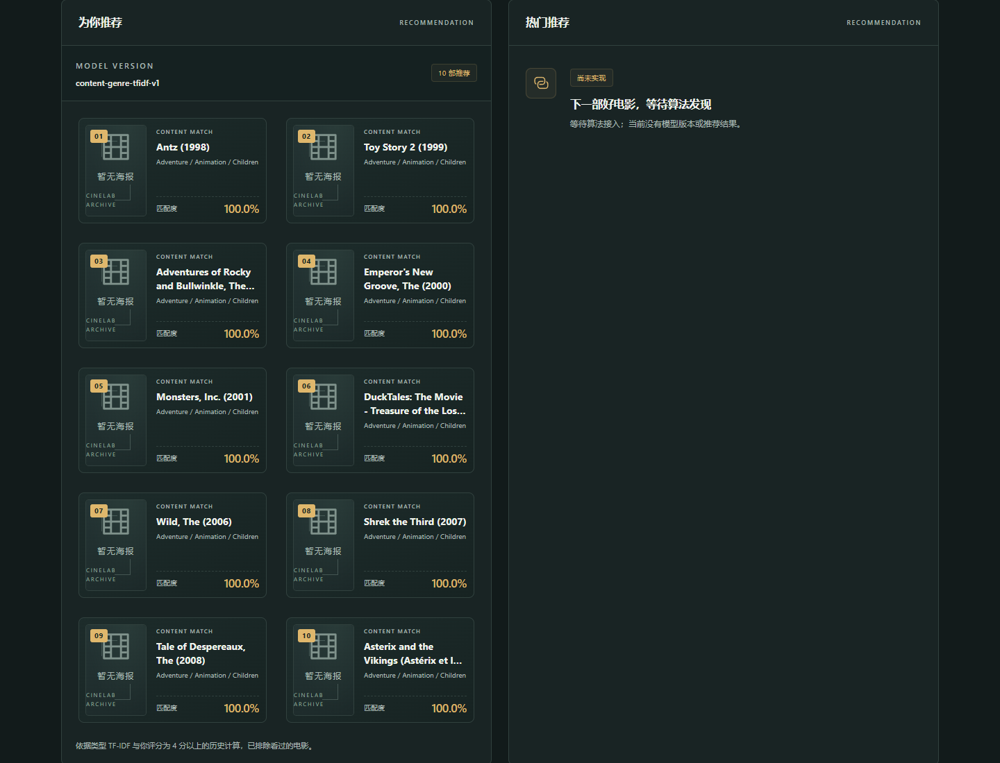
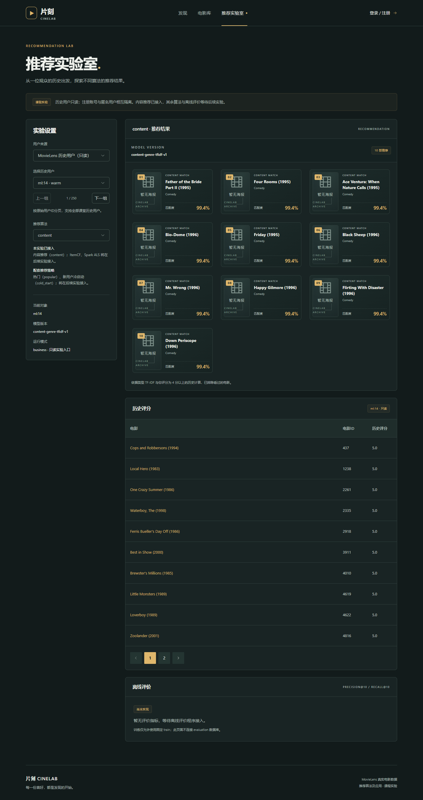

# 实验一：基于内容的推荐

## 实现内容

- 新增 `recommender/student/content.py`，实现同步的 `ContentProvider.recommend(request)`。
- 在 `recommender/contracts.py` 中把 `content` 显式注册到 `PROVIDERS`；其余四种算法保持未实现。
- 新增可复现的模型构建脚本 `scripts/build_content_model.py`。
- 产出 `models/business/content-v1/movie-genres.json` 和 `models/business/content-v1/manifest.json`。
- 前端 `AlgorithmPanel` 不再只显示电影编号：现在展示海报占位、片名、类型、名次和内容匹配度；首页与推荐实验室的文案同步更新。

## 特征与排序

1. 读取冻结的 `movies.csv` 和 `training-catalog.csv`，只为 8459 部批准目录内的电影建立特征。
2. 把 `genres` 按 `|` 拆成类型集合，忽略 `(no genres listed)`。
3. 对 19 个类型计算 IDF：

   `idf(g) = ln((1 + N) / (1 + df(g))) + 1`

4. 每部电影得到 TF-IDF 类型向量，并做 L2 归一化。
5. 用户画像取历史评分 `>= 4.0` 的电影向量，按 `max(rating - 3.0, 0.1)` 加权平均，再归一化。
6. 对候选电影计算余弦相似度；排除所有已评分电影和已收藏电影；按分数降序、同分按 `movie_id` 升序，最多返回 10 部。
7. 没有 4 分以上历史时返回空列表，不伪造个性化结果。

## 模型清单

`manifest.json` 的关键字段：

- `algorithm`: `content`
- `model_version`: `content-genre-tfidf-v1`
- `runtime_mode`: `business`
- `training_files`: 只声明 `business/history_ratings.csv` 及其冻结摘要
- `feature_files`: `movies.csv`、`training-catalog.csv` 及其冻结摘要
- `artifacts`: `movie-genres.json` 的 SHA-256
- `parameters`: 阈值、余弦相似度、Top-10、排除规则

重新生成工件：

```powershell
python scripts/build_content_model.py
```

## 如何检查

### 1. 算法已注册

```powershell
curl.exe -sS http://127.0.0.1:8080/api/v1/experiments/algorithms
```

`content` 应为 `registered`，其余算法仍为 `not_implemented`。

### 2. 历史用户能返回合法 Top-10

```powershell
curl.exe -sS "http://127.0.0.1:8080/api/v1/demo/history-users/14/recommendations/content?limit=10"
```

检查：

- `status` 为 `ready`；
- `items` 长度为 10（或历史不足时更少）；
- `rank` 从 1 连续递增；
- 所有 `movie_id` 都在 8459 部批准目录内；
- 同分时 `movie_id` 升序；
- 结果中没有该用户已评分的电影。

### 3. 登录账号能拿到个性化结果

1. 打开 <http://127.0.0.1:8080/>，登录；
2. 给一部电影打 4 分以上；
3. 回到首页，查看“为你推荐”面板。

当前测试账号 `lab1test_1021` 对《Toy Story》评了 4.5 分，首页会显示《Antz》《Toy Story 2》等 Adventure / Animation / Children 类型电影。两部电影共享这三个类型，因此内容相似度高；这与“按类型 TF-IDF 余弦相似度”的解释一致。

### 4. 前端改动可见

首页“为你推荐”现在显示真实推荐卡片，包含：

- 海报占位或 TMDB 海报；
- 中文名或原始片名；
- 前三个类型；
- `01`—`10` 名次徽标；
- 内容匹配度百分比；
- “依据类型 TF-IDF 与你评分为 4 分以上的历史计算，已排除看过的电影”的说明。





## 自检记录（2026-10-21）

```text
algorithms:
200 [('popular', 'not_implemented'), ('content', 'registered'), ('itemcf', 'not_implemented'), ('als', 'not_implemented'), ('cold_start', 'not_implemented')]

ml:14 recommendations:
items 10 scores [0.993923]
ids ['5', '18', '19', '65', '69', '88', '102', '104', '125', '135']
history ratings 15 total 15

ml:14 limit=5:
items 5

app account:
app:2
items 10 top 2294

empty app account:
app:4
200 {'status': 'ready', 'algorithm': 'content', 'model_version': 'content-genre-tfidf-v1', ... 'items': []}

ALL CHECKS PASSED
```

自检覆盖：注册表状态、Top-10 数量、排名连续、目录内 ID、无重复、同分 ID 升序、排除已评分、`limit` 生效、登录账号个性化、无正反馈时返回空列表且不伪造结果。

## 边界

- 收藏不自动当作高评分；但收藏电影会从推荐中排除，避免重复推荐。
- 评分 `>= 4.0` 才算正反馈；低分电影只用于“已看过”排除，不进入画像。
- `limit` 可以小于 10；大于 10 时仍最多返回 10 部。
- 工件是普通 JSON，不依赖数据库；API 运行时只读挂载 `models/business`。
