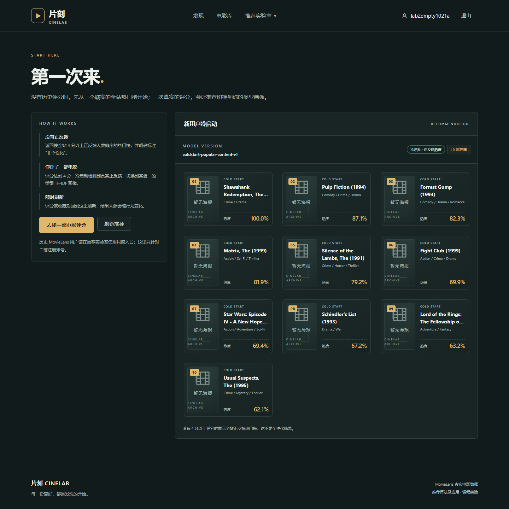
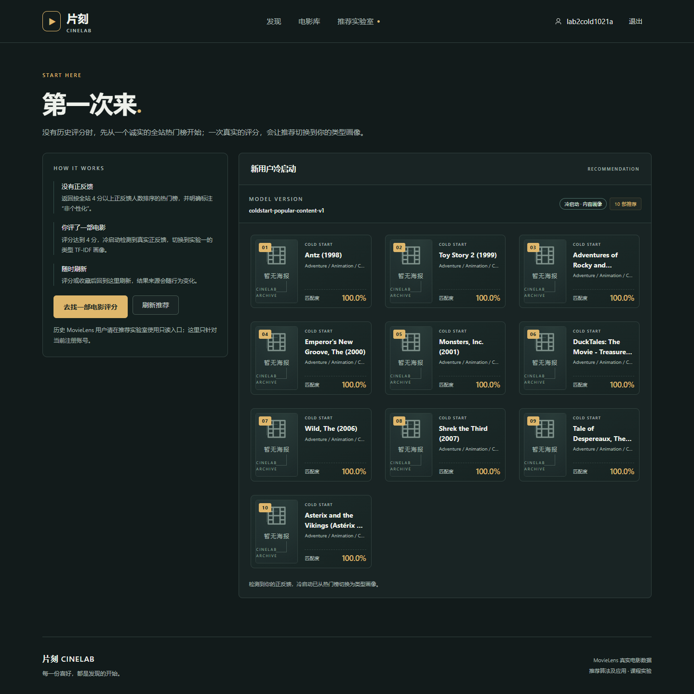
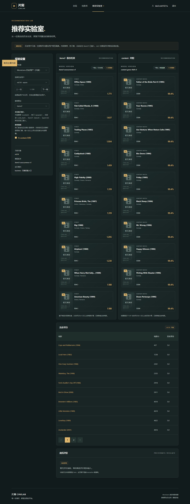

# 实验二：热门榜单、新用户冷启动与 ItemCF

本次实验在实验一的内容推荐基础上，新增三个可独立调用的推荐策略：

| 算法标识 | 策略 | 是否个性化 | 模型版本 |
| --- | --- | --- | --- |
| `popular` | 全站正反馈热门榜 | 否 | `popular-business-v1` |
| `itemcf` | 物品共现协同过滤 | 是 | `itemcf-cooccurrence-v1` |
| `cold_start` | 无正反馈用热门，有正反馈切内容画像 | 条件式 | `coldstart-popular-content-v1` |

三者都已注册到 `recommender/contracts.py` 的 `PROVIDERS`，并通过真实 API、浏览器页面和契约校验。

## 1. 数据与统一口径

- 数据版本：`rec-course-v3-train5-1.0.0`
- 划分：`temporal-v1-cold500-train5-v3`
- schema：`student-eight-v3`
- manifest SHA-256：`fcfb9a195a56709773696aab02f769c691778af0eb433a1e0778a71c4b289b9e`
- business 历史：`business/history_ratings.csv`，798,775 条，5,000 个匿名历史用户，8,459 部电影。
- 正反馈定义：评分 `>= 4.0`；共 398,931 条。
- 所有 Provider 输出最多 10 部，排除当前用户所有已评分电影和已收藏电影；不读取 evaluation 数据，不在 HTTP 请求中训练。

## 2. 热门榜（popular）

### 计算口径

1. 只统计评分 `>= 4.0` 的正反馈。
2. 每部电影统计 `positive_support`（正反馈人数）与 `mean_rating`。
3. 至少 20 个正反馈才进入榜单，避免少量 5 分电影占据榜首。
4. 排序：`positive_support desc, mean_rating desc, movie_id asc`。
5. API 的 `score` 是相对榜首的归一化热度，榜首为 `1.0`，用于展示，不改变排名。

### 工件与清单

- 工件：`models/business/popular-v1/popular.json`（830,362 字节）
- 清单：`models/business/popular-v1/manifest.json`
- 工件 SHA-256：`43e4ffa34e4798c7d7456e206f5bb74a2777601ee78b9dcf6cb23784a4352397`
- 参数：`positive_rating_threshold=4.0`、`min_positive_support=20`、`max_recommendations=10`。

### 为什么它不是个性化

热门榜本身对所有人相同，只做“已看过/已收藏”过滤。因此页面把它标为 **非个性化 · 正反馈热度**，而不是“为你推荐”。这也是冷启动无评分时的诚实回退来源。

## 3. ItemCF（itemcf）

### 计算口径

1. 将每个用户的正反馈（`rating >= 4.0`）视为二值交互。
2. 电影向量为“哪些用户正反馈过它”，物品相似度为余弦：
   `sim(i,j) = cooccur(i,j) / sqrt(support(i) * support(j))`。
3. 只保留至少 20 个正反馈的电影，且共现至少 5 次，避免偶然共现。
4. 每部电影保留最多 50 个最近邻。
5. 推荐时，用户每个正反馈种子按 `max(rating - 3.0, 0.1)` 加权，累加邻居相似度；排除已评分/已收藏；按累计分降序、同分 `movie_id` 升序，取前 10。
6. 因为多个种子会累加，ItemCF 的 `score` 可以大于 1；前端因此用“推荐分”而不是百分比展示。

### 工件与清单

- 工件：`models/business/itemcf-v1/item-similarities.json`（3,243,899 字节，3,000 部电影有邻居）
- 清单：`models/business/itemcf-v1/manifest.json`
- 工件 SHA-256：`517afb41b69a4a7c46f144663e2a6a6afa9e2e73e34141911b36cd28b769bc0f`
- 参数：`min_item_support=20`、`min_cooccurrence=5`、`max_neighbors=50`、`positive_rating_threshold=4.0`。

## 4. 冷启动（cold_start）

### 策略

冷启动不是第四个独立模型，而是可解释的路由策略：

1. 当前账号没有任何 `>= 4.0` 的评分：返回 `popular` 榜单，来源标记为 `cold_start_popular`，页面显示 **冷启动 · 正反馈热度**。
2. 当前账号出现至少一条 `>= 4.0` 评分：调用实验一的 `content` 画像，来源标记为 `cold_start_content`，页面显示 **冷启动 · 内容画像**。
3. 如果内容画像因候选耗尽返回空，再回退热门榜，不伪造个性化结果。

- 策略工件：`models/business/cold-start-v1/cold-start.json`
- 清单：`models/business/cold-start-v1/manifest.json`
- 工件 SHA-256：`c176f809a43c9b6d07bf2778b8c969def86105d1abca2a401616748facd8ad09`
- 模型版本：`coldstart-popular-content-v1`

## 5. 前端入口

新增独立页面 `/cold-start`：

- 未登录：提示登录；
- 登录但无评分：显示热门榜，并明确说明“不是个性化结果”；
- 有 4 分以上评分：显示类型画像结果；
- “刷新推荐”按钮会在评分/收藏后重新请求；
- 首页增加“第一次来，也能从热门开始”的可操作入口。

推荐实验室新增“与 content 对照”复选框，可在同一历史用户上并排比较 ItemCF 与内容推荐；推荐卡片会显示策略标签、模型版本、分数口径和排除说明。

截图：







## 6. 自检记录

### 6.1 模型清单与契约

```powershell
python -m compileall -q recommender scripts
```

三个清单均通过 `recommender.validation.check_model`；三个 Provider 的输出均通过 `check_result`，包括：目录内 ID、无重复、排名连续、同分 ID 升序、算法/模型版本一致。

### 6.2 注册状态

```powershell
curl.exe -s http://127.0.0.1:8080/api/v1/experiments/algorithms
```

结果：`popular`、`content`、`itemcf`、`cold_start` 为 `registered`，`als` 仍为 `not_implemented`。

### 6.3 历史用户 `ml:14`

```powershell
curl.exe -s "http://127.0.0.1:8080/api/v1/demo/history-users/14/recommendations/popular?limit=10"
curl.exe -s "http://127.0.0.1:8080/api/v1/demo/history-users/14/recommendations/itemcf?limit=10"
curl.exe -s "http://127.0.0.1:8080/api/v1/demo/history-users/14/recommendations/cold_start?limit=10"
```

| 算法 | 前 3 部电影 | 分数口径 |
| --- | --- | --- |
| popular | 318, 296, 356 | 归一化热度 1.000 / 0.871 / 0.823 |
| itemcf | 2502, 1079, 3039 | 推荐分 1.771 / 1.637 / 1.504 |
| cold_start | 5, 18, 19 | 匹配度 0.993923（检测到正反馈，来源 `cold_start_content`） |

### 6.4 新账号从无评分到有评分

测试账号 `lab2empty1021a`（无评分）：

- `/me/recommendations/cold_start` 返回 10 部，`recall_sources=["cold_start_popular"]`；
- 页面显示“冷启动 · 正反馈热度”。

测试账号 `lab2cold1021a` 对电影 `1` 评分 `4.5` 后：

- 同一接口返回 10 部，`recall_sources=["cold_start_content"]`；
- 页面显示“冷启动 · 内容画像”，首部为 `2294`（Antz）；
- 电影 `1` 被排除，无重复。

### 6.5 排除与去重

对 `lab2cold1021a` 检查 `popular`、`itemcf`、`content`、`cold_start`：

- 四个算法均返回 10 部；
- 均不包含已评分的电影 `1`；
- 均无重复 ID。

## 7. 一个具体的内容 vs ItemCF 对照案例

同一历史用户 `ml:14`：

- `content` 前 10 部全部是 Comedy，匹配度都是 `99.4%`：`Father of the Bride Part II`、`Four Rooms`、`Ace Ventura: When Nature Calls`、`Bio-Dome`、`Friday`、`Black Sheep`、`Mr. Wrong`、`Happy Gilmore`、`Flirting with Disaster`、`Down Periscope`。
- `itemcf` 前列是 `Office Space`、`A Fish Called Wanda`、`Trading Places`、`Caddyshack`、`High Fidelity`、`The Princess Bride`、`Big`、`Airplane!`、`When Harry Met Sally...`、`American Beauty`，分数在 `1.771` 到 `1.188` 之间。

解释：

- 内容推荐只看类型向量，`ml:14` 的正反馈集中在 Comedy，因此所有 Comedy 都得到相同的类型相似度，排序主要由类型和 ID 决定；它无法区分“同一类型里这位用户具体喜欢哪一部”。
- ItemCF 看“哪些电影被同一批人正反馈过”。`Office Space` 与 `ml:14` 看过的喜剧共现更强，所以排在第一；`The Princess Bride`、`American Beauty` 类型并不完全是纯喜剧，却因行为共现进入榜单。
- 这正是内容相似与行为共现的差异：前者可解释、冷启动友好，后者更贴近群体行为，但需要足够的交互数据，也会受热门度影响。

## 8. 复现与边界

```powershell
# 重新生成三个工件（需要 numpy/scipy）
python scripts/build_lab2_models.py

# 只重建后端（标准构建；需要 Docker Hub 可达）
powershell -ExecutionPolicy Bypass -File deployment/build.ps1 -Target backend
```

本次本机 Docker Hub 不可达，验收时使用离线基础镜像派生 `cinelab-local/api:lab2` 和 `cinelab-local/web:lab2`，未修改仓库的 `compose.yaml` 或 `deployment/`。正式环境仍按课程文档执行 `student-tools.ps1` 和 `build.ps1`。

当前边界：

- 尚未实现 Spark MLlib ALS，因此 `als` 仍返回 501；
- 尚未接入离线 Precision@10 / Recall@10，实验三完成；
- ItemCF 使用固定 top-50 邻居，未做 ANN 或增量更新；
- `cold_start` 的“主动收集偏好”采用真实评分触发，不伪造问卷或前端假数据。
