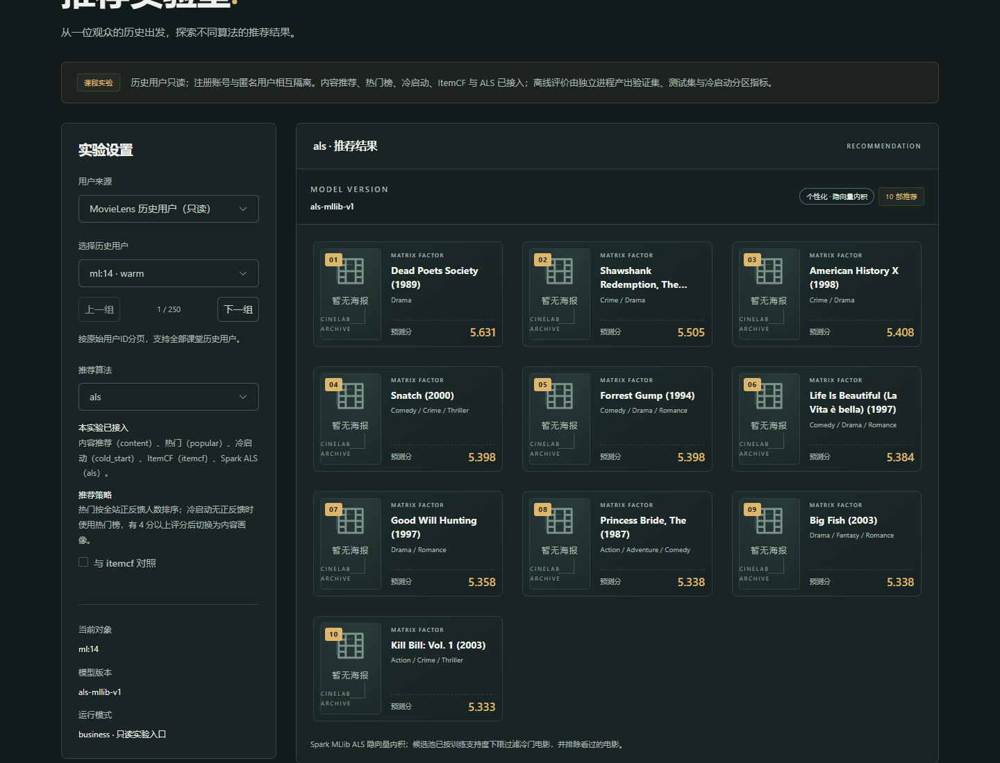
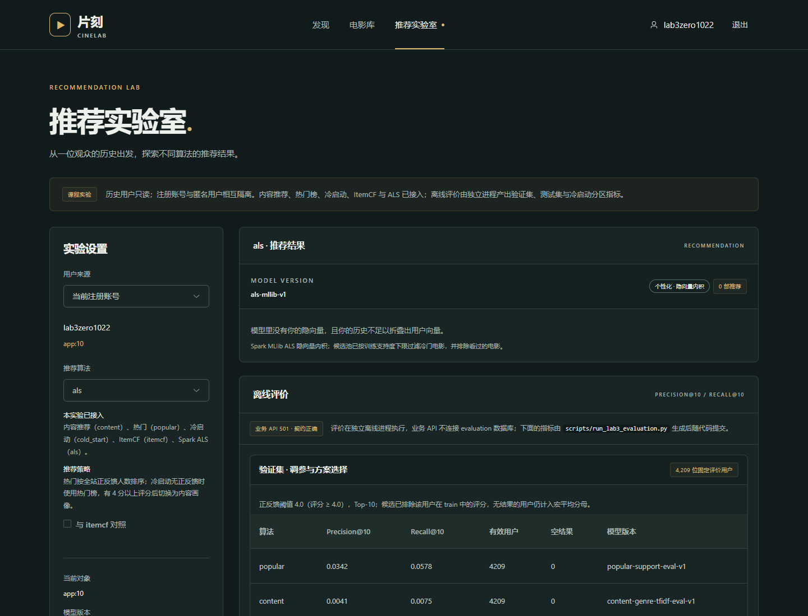
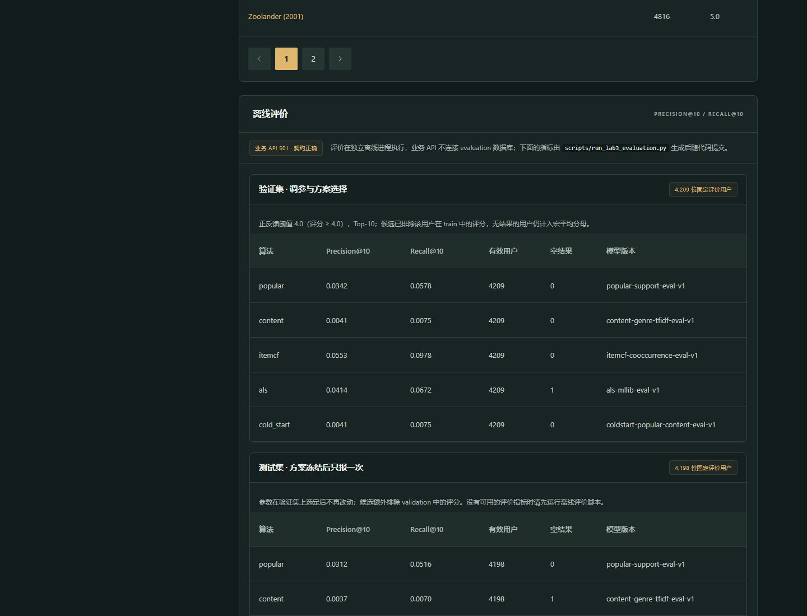
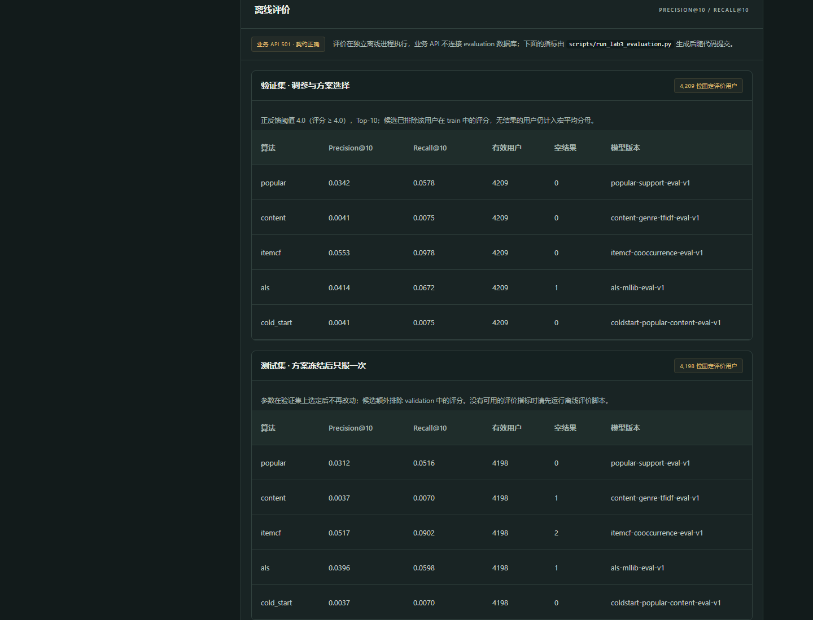
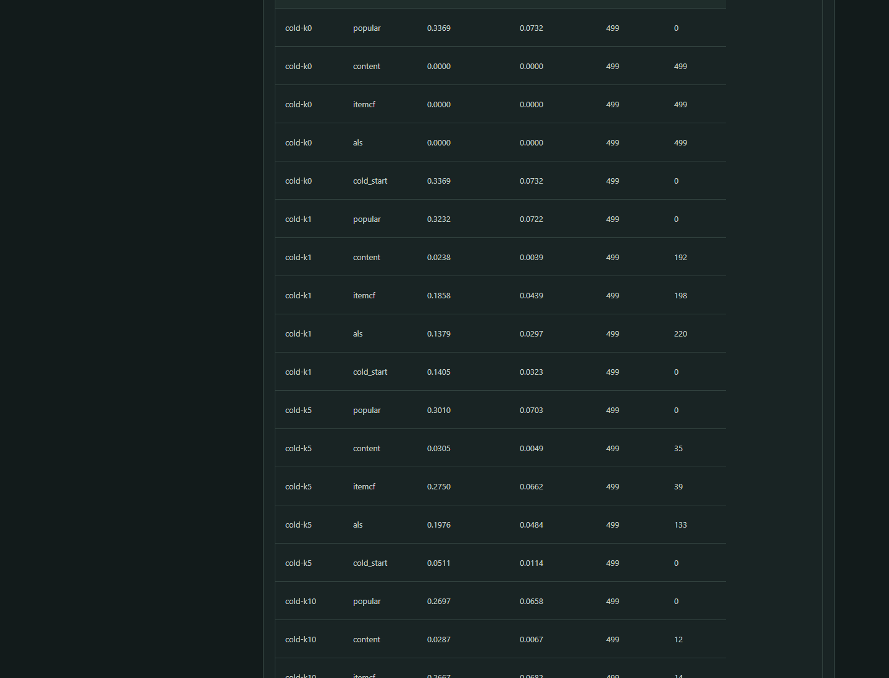

# 实验三：Spark ALS 与统一离线评价

本文件记录第三次实验的实现与验收：用冻结 train 训练真实 Spark MLlib ALS，把
Popular / Content / ItemCF / ALS 放进同一套评价协议，并把结果接进既有系统。

- 数据版本：`rec-course-v3-train5-1.0.0`，划分：`temporal-v1-cold500-train5-v3`，schema：`student-eight-v3`
- 业务模型：`models/business/als-v1/`（只读挂载进 API 容器，服务真实接口）
- 评价模型：`models/evaluation/als-v1/`（只被独立离线进程加载，API 永远不会读到）
- 评价指标：`docs/lab3-evaluation-table.md`（由 `scripts/publish_lab3_metrics.py` 生成）
- 网页展示：实验页「离线评价」面板读取 `frontend/src/data/lab3-metrics.json`，与上面同一份数字

## 1. LFM 与 ALS 的关系

LFM（隐语义模型）把「用户 × 电影」矩阵近似成两个低维矩阵的乘积：用户向量
`p_u` 与电影向量 `q_i` 的内积 `p_u · q_i` 就是预测评分，隐空间的每一维可以理解
成一种数据自己学出来的口味轴（不是人工标注的类型）。

ALS（交替最小二乘）是求解 LFM 的一种具体算法：固定电影向量时，每个用户的向
量有闭式解；固定用户向量时，每部电影的向量也有闭式解，于是两边交替求解直到收
敛。它比随机梯度下降更容易并行（每次迭代只做矩阵运算），代价是显式评分矩阵通
常很稀疏，需要用正则项 `regParam` 抑制过拟合。本次实现用 `implicitPrefs=False`
训练显式评分，`coldStartStrategy="drop"` 让预测阶段不产生 NaN。

**评分预测 ≠ Top-N 排序**：ALS 的损失函数优化的是「猜准分数」，不是「把用户真
会喜欢的电影排到前面」。评分矩阵只有 58 万余条，8459 部电影的长尾部分人均反馈
极少，模型对这些电影的隐向量几乎靠正则项决定，因此内积排序出来的结果容易被长尾
噪声占据——实验数据里这一点非常明显（见第 4 节的支持度下限）。所以 Top-N 场景
需要额外的候选裁剪与重排，而不是直接把分数最高的一批电影交出去。

## 2. 训练与工件

`scripts/build_lab3_als.py` 是唯一训练入口，宿主运行（镜像里没有 Java/Spark）：

```powershell
$env:JAVA_HOME="C:\Program Files\Microsoft\jdk-11.0.16.101-hotspot"
D:\Python311\python.exe scripts\build_lab3_als.py --mode evaluation   # 评价侧模型
D:\Python311\python.exe scripts\build_lab3_als.py --mode business     # 业务侧模型（复用调参结果）
```

- 训练数据只来自 `FrozenData().training()`，也就是 `evaluation/train.csv`（583,502 行）；
  business 侧模型用 `business/history_ratings.csv`（798,775 行），两者绝不混用。
- 第一段网格：`rank ∈ {8,16,32} × regParam ∈ {0.05,0.1,0.2}`，每轮 12 次迭代，
  只在固定的 4,209 位验证集用户上按宏平均 Precision@10 选参数（并列时看 Recall@10，
  再取更小的 regParam/rank）。
- 第二段网格：固定上一步的 rank/regParam，比较候选支持度下限
  `{0,100,200,300,500}`，同样只看验证集。
- 第三段：用选中的参数跑 15 次迭代的最终模型，并在验证集上记录一次指标（只作记录，
  不参与选择）。
- 工件 `als-factors.json` 内含用户因子、电影因子、每部电影在拟合文件里的支持度
  （`item_support`）与选中的 `candidate_support_floor`；清单里的 `parameters`
  保存完整调参报告，`tool_versions` 记录 python / pyspark / java 版本。
- 推理侧 `recommender/student/als.py` 是纯 Python 点积（运行镜像没有 numpy）：
  老朋友直接查用户因子；不在因子表里的用户（冷启动分区）用「评分加权电影因子均值」
  折叠出用户向量；低于支持度下限的电影不进入候选；已评分与已收藏的电影全部排除。

## 3. 统一离线评价

`scripts/run_lab3_evaluation.py` 在宿主跑完整流程，`scripts/publish_lab3_metrics.py`
把结果发布成网页数据与文档表格：

```powershell
D:\Python311\python.exe scripts\run_lab3_evaluation.py --algorithm all --partition all
D:\Python311\python.exe scripts\publish_lab3_metrics.py
```

评价严格遵守课程协议：

| 项目 | 做法 |
| --- | --- |
| 拟合数据 | 只读 `evaluation/train.csv`；validation/test/cold query 从不参与训练 |
| 正反馈 | 评分 ≥ 4.0 |
| 候选 | 目录 8459 部，减去该用户在训练侧（validation）或训练+验证侧（test）的评分；冷启动分区减去该用户的 support 评分 |
| Top-N | 10；Precision@10 分母恒为 10，Recall@10 分母是该用户候选内相关目标数 |
| 聚合 | 宏平均；`items=[]` 的用户保留在分母里，不会被悄悄剔除 |
| 调参 | 只在 validation 上做；方案冻结后 test 只报一次 |
| 校验 | 每个分区跑完后调用 `check_predictions` 与 `check_evaluation_result`，逐行复核 DTO、候选排除与用户覆盖 |

评价 Provider 通过 `recommender/student/evaluation_entry.py` 注册（
`python -m recommender.check ... --module recommender.student.evaluation_entry --mode evaluation`），
业务进程加载的是 `models/business/`，两条链路互不影响。

## 4. 结果

完整数字（含每个分区的模型版本、空结果数与生成时间）见
[`docs/lab3-evaluation-table.md`](lab3-evaluation-table.md)，网页「离线评价」面板读的是同一份
`frontend/src/data/lab3-metrics.json`。

### 4.1 主对比表（同一协议、同一候选规则、宏平均）

验证集（4,209 位固定用户，调参与选参数用）：

| 算法 | 有效用户 | 空结果 | Precision@10 | Recall@10 |
| --- | ---: | ---: | ---: | ---: |
| itemcf | 4209 | 0 | 0.055263 | 0.097830 |
| als | 4209 | 1 | 0.041388 | 0.067163 |
| popular | 4209 | 0 | 0.034165 | 0.057788 |
| content | 4209 | 0 | 0.004134 | 0.007459 |
| cold_start | 4209 | 0 | 0.004134 | 0.007459 |

测试集（4,198 位固定用户，方案冻结后只跑这一次）：

| 算法 | 有效用户 | 空结果 | Precision@10 | Recall@10 |
| --- | ---: | ---: | ---: | ---: |
| itemcf | 4198 | 2 | 0.051715 | 0.090174 |
| als | 4198 | 1 | 0.039590 | 0.059773 |
| popular | 4198 | 0 | 0.031205 | 0.051600 |
| content | 4198 | 1 | 0.003740 | 0.006956 |
| cold_start | 4198 | 0 | 0.003740 | 0.006956 |

冷启动四个分区（各 499 人，`-` 表示全员空结果）：

| 分区 | popular | cold_start | itemcf | als | content |
| --- | ---: | ---: | ---: | ---: | ---: |
| k=0 | 0.336874 | 0.336874 | 0.000000 | 0.000000 | 0.000000 |
| k=1 | 0.323246 | 0.140481 | 0.185772 | 0.137876 | 0.023848 |
| k=5 | 0.301002 | 0.051102 | 0.274950 | 0.197595 | 0.030461 |
| k=10 | 0.269739 | 0.036673 | 0.266733 | 0.208617 | 0.028657 |

（表内为 Precision@10；四种算法的 Recall@10 与空结果数见生成表格。）

### 4.2 至少两条基于真实数据的解释

**一、ItemCF 在两个固定用户集合上都排第一（0.055263 → test 0.051715），因为它的
相似度是“共现”而不是“评分”。** 统一协议下正反馈是“评分 ≥ 4.0”，用户的“喜欢”
本质上是二值的，ItemCF 直接学“看了 A 的人还看 B”，与 Top-N 的命中目标一致；它还有
`MIN_ITEM_SUPPORT=20`、`MIN_COOCCURRENCE=5`、`MAX_NEIGHBORS=50` 三重门槛，
相似邻居只在有统计支撑的物品之间产生，长尾噪声进不来。验证集到测试集 Precision@10
只掉了 6.4%（0.055263 → 0.051715），说明这个优势不是过拟合验证集。

**二、ALS 排第二（验证 0.041388），但差距主要来自“评分预测 ≠ Top-N”，这一点在数据里
是数量级的。** 同一次调参里，`rank=32, regParam=0.05` 直接用全部 8,459 部电影做候选时
验证集 Precision@10 只有 0.005393；把候选限制到“拟合文件内支持度 ≥ 500”的 193 部之后
跳到 0.041601（网格：0 → 0.005393，100 → 0.026895，200 → 0.033737，300 → 0.037325，
500 → 0.041601，见清单里的 `support_floor_report`；500 已是网格里最紧的一档（候选
193 部），再往上候选会不足 200 部，收益空间很小，因此没有继续扩大网格）。
也就是说，一个在评分预测意义上训练良好的模型，如果不做候选裁剪，Top-10 会被长尾物品
的隐向量噪声占满。第一段网格（rank ∈ {8,16,32} × regParam ∈ {0.05,0.1,0.2}）也是
同样的结论：16 维只有 0.001473，32 维才到 0.005393，低维模型在长尾上更糊。

**三、Content 与 cold_start 在验证/测试集上完全相同（0.004134 / 0.003740），这是
策略使然，不是复制粘贴。** `ColdStartProvider` 对“至少有一条正反馈”的用户直接改用内容
画像（`recall_sources` 会标成 `cold_start_content`），只有零反馈用户才回落到热门榜；
验证/测试集的 4,209/4,198 位用户按定义都有历史，所以两列逐位相同，而 `content` 自身的
类型 TF-IDF 只有 20 个粗类型维度，同类型内部无法区分，命中率天然低（约为 ItemCF 的
1/13）。到了冷启动分区，cold_start 回到热门榜并与 popular 完全一致（k=0 时两者都是
0.336874）。

**四、冷启动分区里“个性化方法随 k 上升、热门随 k 上升而下降”。** 候选规则要求排除该
用户 support 里已评分的电影，所以 k 越大，固定热门榜被削掉的条目越多，popular 从
0.323246 降到 0.269739；反过来，ItemCF 拿到 1/5/10 条 support 后从 0.185772 升到
0.266733（k=10 时几乎追平热门），ALS 用“评分加权电影因子均值”折叠出用户向量后从
0.137876 升到 0.208617。k=0 时 content/itemcf/als 无从下手（无画像、无共现对象、
拟合文件里没有该用户），全部 499 人返回空结果——按协议这些用户仍然留在分母里，
没有被剔除。

### 4.3 调参记录（只在验证集上做）

| 阶段 | 网格 | 选中 |
| --- | --- | --- |
| rank/regParam（12 次迭代） | 8/16/32 × 0.05/0.1/0.2 | rank=32, regParam=0.05（P@10=0.005393） |
| 候选支持度下限 | 0/100/200/300/500 | 500（P@10=0.041601，候选 193 部） |
| 最终模型（15 次迭代） | — | 验证集 P@10=0.041388 / R@10=0.067163（只记录，不参与选择） |

最终模型在验证集上的这条记录与 `reports/lab3/als/validation.evaluation-result.json`
以及上表 ALS 行完全一致，`task_sha256`、`user_ids_sha256`、`model_manifest_sha256`
都由 `recommender.check` 复核通过。

## 5. 复现与自检

```powershell
# 1) 模型清单与数据摘要（宿主即可，不需要数据库）
D:\Python311\python.exe -m recommender.check model models/business/als-v1/manifest.json --mode business
D:\Python311\python.exe -m recommender.check model models/evaluation/als-v1/manifest.json --mode evaluation

# 2) 评价入口自检（独立进程；不指定分区时默认 validation）
D:\Python311\python.exe -m recommender.check selfcheck --module recommender.student.evaluation_entry `
  --algorithm als --mode evaluation --subject-kind ml --subject-id 14
$env:CINELAB_EVALUATION_PARTITION = "cold-k1"      # 要自检冷启动分区时先指定分区
D:\Python311\python.exe -m recommender.check selfcheck --module recommender.student.evaluation_entry `
  --algorithm als --mode evaluation --subject-kind ml --subject-id 55
Remove-Item Env:\CINELAB_EVALUATION_PARTITION

# 3) 六个分区的预测文件与结果文件复核
foreach ($p in "validation", "test", "cold-k0", "cold-k1", "cold-k5", "cold-k10") {
  D:\Python311\python.exe -m recommender.check predictions "reports\lab3\als\$p.predictions.jsonl" `
    --model models/evaluation/als-v1/manifest.json --partition $p
  D:\Python311\python.exe -m recommender.check evaluation-result "reports\lab3\als\$p.evaluation-result.json" `
    --model models/evaluation/als-v1/manifest.json
}

# 4) 业务侧 Provider 自检（在 api 容器里跑；镜像入口 deployment/serve.py 自己读密钥，
#    临时 exec 起来的新进程不会继承，所以要显式补这两个变量）
docker compose exec -T api sh -c "APP_DB_PASSWORD=$(cat /run/secrets/app_password) APP_JWT_SECRET=$(cat /run/secrets/jwt_secret) python -m recommender.check selfcheck --algorithm als --subject-kind ml --subject-id 14"

# 5) HTTP 接口
curl.exe -s "http://127.0.0.1:8080/api/v1/experiments/algorithms"
curl.exe -s "http://127.0.0.1:8080/api/v1/demo/history-users/14/recommendations/als?limit=10"
```

容器列表里应当仍然是 `cinelab-db-1` / `cinelab-api-1` / `cinelab-web-1` 三件套；
`/api/v1/experiments/algorithms` 应显示五个算法 `registered`。

## 6. 边界与说明

- 宿主训练依赖写在 `scripts/requirements-lab3.txt`（`pyspark==3.5.3`）。按课程说明，
  Java/Spark 属于需要教师审阅的额外构建输入，因此没有塞进 `backend/requirements.lock.txt`，
  运行镜像保持原样（镜像里没有 Java，也无法训练）。
- 支持度下限是在验证集上选的超参数，不是看 test 调的；它只用拟合文件自己的统计量，
  不使用任何验证/测试标签。选择过程与报告都在清单的 `parameters` 里，可复核。
- 冷启动分区的 support 评分只用于逐用户推断（折叠用户向量），query 只当标签；
  k=0 分区没有 support 评分，模型不会声称个性化——这些用户在 `als` 上返回空结果，
  与热门/冷启动策略的对比见结果表。
- 没有把 validation 并回 train 重训，也没有为了让某个算法好看而改动候选集或分母。
- 模型工件是按 SHA-256 绑定的：`.gitattributes` 对 `models/business/**` 与 `models/evaluation/**`
  关闭了换行转换（`-text`）。否则 Git 规范化会把文件末尾的 CRLF 改成 LF，克隆出来的工件
  与清单里的摘要差一个字节，评审端 `check_model` 就会失败。可以用
  `git clone` 后核对摘要的方式复现这一点。

## 7. 基础版检查记录

“基础版能展示内容、ItemCF、ALS、热门及冷启动”的逐项检查（2026-10-22，本机浏览器 + 命令复核）：

| 检查项 | 检查方式 | 结果 |
| --- | --- | --- |
| 环境与数据 | 课程工具 `-Action environment` / `-Action diagnose`；`/health/ready` | 全通过；HTTP 200，dataset/split/schema/manifest 与冻结版本一致 |
| 算法注册表 | `GET /api/v1/experiments/algorithms` | `popular` / `content` / `itemcf` / `als` / `cold_start` 五个 `registered` |
| 内容推荐 | 注册账号评分后的首页“为你推荐” | 10 条，含类型与匹配度（实验一记录） |
| 热门榜单 | `GET /api/v1/demo/history-users/14/recommendations/popular` | 10 条，Top-1 `318`（实验二记录） |
| 冷启动 | 零历史账号的 `/cold-start` 与 `cold_start` 结果 | 10 条，来源 `cold_start_popular`（实验二记录） |
| ItemCF | `GET /api/v1/demo/history-users/14/recommendations/itemcf` | 10 条（实验二记录） |
| ALS（本实验） | `GET /api/v1/demo/history-users/14/recommendations/als?limit=10` | 10 条，`als-mllib-v1`，预测分 5.631 / 5.505 / 5.408…，与 ml:14 的历史无交集 |
| ALS 空结果边界 | 新注册账号 `lab3zero1022`（app:10）在实验页查看 `als` | 返回 0 条并显示说明“模型里没有你的隐向量……”，不是报错，也没有伪造结果 |
| 业务 Provider 自检 | 容器内 `python -m recommender.check selfcheck --algorithm … --subject-kind ml --subject-id 14`（五个算法） | 五次全部 `selfcheck_passed`，`items=10`，版本分别为 `popular-business-v1` / `content-genre-tfidf-v1` / `itemcf-cooccurrence-v1` / `als-mllib-v1` / `coldstart-popular-content-v1` |
| 评价工件复核 | `python -m recommender.check predictions/evaluation-result`（ALS 六个分区） | 12 次全部 `validated_predictions` / `validated_evaluation_result` |
| 离线评价展示 | 实验页“离线评价”面板 | 验证集 5 行、测试集 5 行、冷启动 20 行，指标与 `reports/lab3/summary.json` 一致 |
| 业务 API 不碰评价数据 | `GET /api/v1/experiments/evaluations` | HTTP 501 `EVALUATION_NOT_IMPLEMENTED`（契约行为：评价只在独立进程跑），页面因此展示脚本生成的指标文件 |

网页证据：











## 8. 课堂任务提交说明（简短）

提交位置：私有仓库 `https://github.com/20041021-hub/cinelab-recommendation-lab`
（`a22c239` 代码与模型、`dffcb01` 文档与截图；本节与 ml:55、算法注册表两张图在后续 docs 提交里）。

### 8.1 任务一 · 真实 Spark ALS 训练与个性化 Top-10

- 训练脚本 `scripts/build_lab3_als.py`：`pyspark==3.5.3` + JDK 11.0.16.1，`spark.ml.recommendation.ALS`
  显式评分（`implicitPrefs=False`、`seed=20261022`），拟合文件是冻结的 `evaluation/train.csv`（583,502 行）。
- 选定参数：**rank=32、regParam=0.05、maxIter=15、candidate_support_floor=500**。选择过程与全部候选分数写在
  `models/evaluation/als-v1/manifest.json` 的 `parameters.tuning`（rank×regParam 网格 9 组 + 支持度下限网格 5 组，均在验证集上比较）。
- 工件：`models/evaluation/als-v1/als-factors.json`（4,137,412 B，sha256 `2499ba37…`）、
  `models/business/als-v1/als-factors.json`（4,212,640 B）；两个清单都通过 `python -m recommender.check model …`。
- 个性化结果（`GET /api/v1/demo/history-users/{id}/recommendations/als?limit=10`，模型版本 `als-mllib-v1`）：
  - **ml:14**（warm，15 条历史）→ `1246 / 318 / 2329 / 4011 / 356 / 2324 / 1704 / 1197 / 7147 / 6874`，
    预测分 5.631 / 5.505 / 5.408 …，与本人已评分的交集 **0**。
  - **ml:55**（cold，19 条历史）→ `593 / 318 / 110 / 3578 / 527 / 356 / 1198 / 4306 / 1 / 1036`，
    预测分 5.410 / 5.284 / 5.208 …，与本人已评分的交集 **0**。
  - 两个用户的列表不同，说明结果随历史变化；ml:55 属于冷启动分区，模型里没有它的隐向量，走的是折叠（fold-in）路径，
    没有退化成“热门榜”。
  - 证据：`images/lab3-als-ml14.png`、`images/lab3-als-ml55.png`。

### 8.2 任务二 · 统一协议下的四算法离线评价

完整表格见 §4.1 与 `docs/lab3-evaluation-table.md`（同一口径：正反馈 ≥ 4.0、Top-10、宏平均、
Precision@10 分母恒为 10、Recall@10 分母为该用户候选集内相关目标数、无结果用户保留在分母中）。

| 分区 | itemcf | als | popular | content | cold_start |
| --- | --- | --- | --- | --- | --- |
| validation（4,209 人） | **0.055263 / 0.097830** | 0.041388 / 0.067163 | 0.034165 / 0.057788 | 0.004134 / 0.007459 | 同 content |
| test（4,198 人，冻结后只报一次） | **0.051715 / 0.090174** | 0.039590 / 0.059773 | 0.031205 / 0.051600 | 0.003740 / 0.006956 | 同 content |

（每格为 Precision@10 / Recall@10；各分区有效用户数与空结果数在 §4.1 表内列出，ALS 在验证集有 1 位空结果用户，
没有被剔除。）

### 8.3 任务三 · 对比与解释（两条，均来自上面的真实数字）

1. **ItemCF 明显最好，ALS 第二**：ItemCF 直接建模“被同一批用户高分评价”的共现关系，而验证集候选规则恰好是
   “目录减 train”，共现证据密集；ALS 优化的是评分预测目标（内积拟合观测评分），对从未被交互的电影只能靠隐向量外推，
   噪声更大。把候选支持度下限从 0 提到 500，ALS 的 P@10 才从 0.005393 升到 0.041601（候选池 8,459 → 193 部），
   这也说明“评分预测好 ≠ Top-N 排序好”。
2. **Content 最低，但冷启动场景不可替代**：内容推荐只用类型多热向量，粒度太粗，无法区分同一类型内的强弱偏好，
   所以在有历史的用户上垫底；但在冷启动 k=1 分区它就能出分（0.023848 / 0.003930），而热门榜单、ItemCF、ALS
   在 k=0 分区都无法个性化（ALS 在该分区 499 人全部空结果）。

### 8.4 任务四 · 集中检查基础版

见 §7 的 12 行检查记录与 5 张截图；本次另外补拍了下拉框证据 `images/lab3-algorithms-registry.png`
（核心算法 content / itemcf / als 与配套策略 popular / cold_start 五个都在系统里可选）。