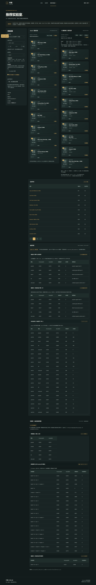
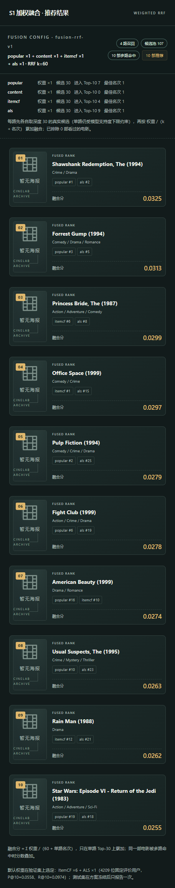
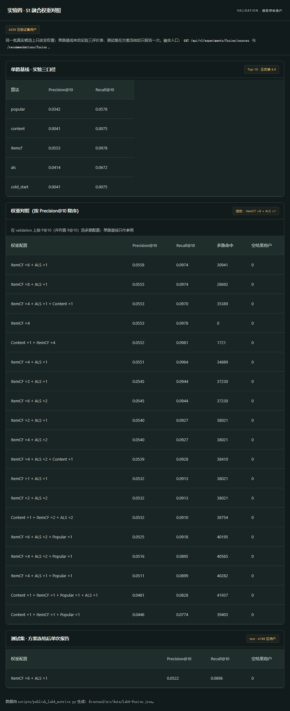

# 实验四 S1：加权 RRF 融合

本文件记录实验四第一个扩展点（S1 加权倒数名次融合）的设计、离线对照实验、前端呈现与端到端验收。
实验四要求在三项扩展里选两项：本轮先做 **S1 加权 RRF**，实验五再做 **S3 Kafka 实时行为**。

## 1. 目标

- 用两种以上**真实候选**（不是拼接、不是伪造）做多路融合，输出一份可解释的 Top-10。
- 在同一批候选上只改变权重，用与实验三完全一致的离线协议（validation 4,209 位固定评价用户、正反馈 ≥ 4.0、Top-10、候选排除该用户在 train 中的评分、宏平均 P@10/R@10）做权重对照实验，并据此选定默认配置。
- 方案冻结后在 test 上只报告一次。
- 前端能直接切换融合方案，看到每一路贡献了多少候选、哪几路共同命中同一部电影。

## 2. 融合原理

四种算法的 `score` 量纲互不相同：Content 是 TF-IDF 余弦、ItemCF 是共现余弦、Spark ALS 是隐向量内积（未归一，5 分上下）、Popular 是正反馈占比。直接加权求和没有可比性，因此本题采用 **RRF（Reciprocal Rank Fusion）**，只融合名次：

```
score(movie) = Σ_sources  weight_s / (K + rank_s(movie))      K = RRF_K = 60
```

- 只有出现在某一路候选里的电影才获得该路贡献；同一部电影被多路召回时**只保留一条**，各来源名次记录在 `recall_ranks` 里。
- 取候选后按 `(-score, int(movie_id))` 排序，同分按电影 ID 数值升序，与冻结契约一致。
- 每路先各自取**更深候选**再融合：`depth = max(20, min(50, limit * 3))`（`limit=10` 时深度 30）。四路 provider 的返回上限已从 10 调到 50，融合才有素材。
- 融合层再做一次过滤：已评分 / 已收藏的电影丢弃（计入 `filtered_seen`），不在冻结目录 8459 部之内的 `movie_id` 丢弃（计入 `filtered_out_of_catalog`）。

代码：`recommender/student/rrf.py`

```python
FUSION_LABEL = "fusion"; MODEL_VERSION = "fusion-rrf-v1"; METHOD = "weighted_rrf"; RRF_K = 60
DEFAULT_SOURCES = (Algorithm.itemcf, Algorithm.als); DEFAULT_WEIGHTS = (6.0, 1.0)
def parse_sources(value) -> tuple[Algorithm, ...]        # 去重、至少 2 路、未知算法报错
def parse_weights(value, count) -> tuple[float, ...]     # 0 < w ≤ 10，个数必须一致
def source_request_limit(limit) -> int                   # max(20, min(50, limit * 3))
def fuse(results, weights, limit, excluded, catalog) -> FusionOutcome   # items/stats/pool_size/...
def exclusion_ids(history) -> set[str]                   # 已评分 + 已收藏
```

**为什么不注册进 `PROVIDERS`**：冻结契约的 `Algorithm` 枚举只有 `popular/content/itemcf/als/cold_start` 五种，融合是实验四/五的扩展能力，注册进去会破坏 `check_request`/`check_result` 的算法一致性校验。因此融合通过独立路由暴露，且每一路候选仍然调用既有 provider 的真实 `recommend()`，异常时明确报错、不静默降级。

## 3. 接口

后端：`backend/app/fusion.py`，在 `backend/app/main.py` 中注册。

| 路由 | 说明 |
| --- | --- |
| `GET /api/v1/experiments/fusion/sources` | 融合元数据：`label`、`model_version`、`method`、`rrf_k`、`default_weights`、可用来源 |
| `GET /api/v1/demo/history-users/{ml_user_id}/recommendations/fusion` | 历史用户（ml）融合推荐 |
| `GET /api/v1/me/recommendations/fusion` | 当前登录账号（app）融合推荐 |

查询参数：

| 参数 | 默认 | 约束 |
| --- | --- | --- |
| `algorithms` | `itemcf,als` | 英文逗号分隔、去重、至少 2 路；只能是五种算法名 |
| `weights` | 默认配置时为 `6,1`，其余情况全 `1` | 个数必须与 `algorithms` 一致；`0 < w ≤ 10` |
| `limit` | `10` | `1 ≤ limit ≤ 50` |

响应（`FusionResult`）：`status`、`algorithm=fusion`、`model_version=fusion-rrf-v1`、`method=weighted_rrf`、`rrf_k`、数据版本、`subject_key`、`generated_at`、`requested_limit`、`candidate_depth`、`pool_size`、`delivered`、`filtered_seen`、`filtered_out_of_catalog`、`weights`、`sources[]`（每路 `weight/candidate_count/contributed/best_rank/model_version`）、`items[]`（`movie_id/rank/score/recall_sources/recall_ranks`）。

错误码（统一错误信封，带 `request_id`）：

| 场景 | HTTP | code | message |
| --- | --- | ---: | --- |
| 只给一路 | 422 | `FUSION_SOURCES_INSUFFICIENT` | 加权 RRF 至少需要 2 路真实候选，当前只有 1 路 |
| 未知算法 | 422 | `FUSION_SOURCE_UNKNOWN` | 未知算法：只能使用 popular、content、itemcf、als、cold_start |
| 权重个数不符 | 422 | `FUSION_WEIGHTS_INVALID` | 权重个数（3）必须与算法个数（2）一致 |
| 权重越界 | 422 | `FUSION_WEIGHTS_INVALID` | 权重必须大于 0 且不超过 10 |
| `limit` 越界 | 422 | `VALIDATION_ERROR` | 请求参数不合法（`details` 指出位置与类型） |
| 历史用户不存在 | 404 | `HISTORY_USER_NOT_FOUND` | 历史匿名用户不存在 |
| 未登录访问 `/me` | 401 | `AUTHENTICATION_REQUIRED` | 请先登录或重新登录 |
| 某一路未实现 | 503 | `FUSION_SOURCE_UNAVAILABLE` | 来源算法 X 尚未实现（`details.reason=not_implemented`） |

## 4. 权重对照实验（validation）

脚本：`scripts/eval_lab4_fusion.py`（19 组权重配置，同一批真实候选，只改权重）；发布脚本：`scripts/publish_lab4_metrics.py`。
完整表见 [lab4-fusion-table.md](lab4-fusion-table.md)，前端随代码发布的版本是 `frontend/src/data/lab4-fusion.json`。

单路基线（实验三评价表，validation 4,209 人）：

| 算法 | Precision@10 | Recall@10 |
| --- | ---: | ---: |
| ItemCF | 0.055263 | 0.097830 |
| Spark ALS | 0.041388 | 0.067163 |
| Popular | 0.034165 | 0.057788 |
| Content / ColdStart | 0.004134 | 0.007459 |

对照实验前六名：

| 权重配置 | 来源数 | Precision@10 | Recall@10 | 多路命中 |
| --- | ---: | ---: | ---: | ---: |
| **ItemCF ×6 + ALS ×1** ✅ | 2 | **0.055785** | 0.097399 | 30,941 |
| ItemCF ×8 + ALS ×1 | 2 | 0.055524 | 0.097375 | 28,692 |
| ItemCF ×4 + ALS ×1 + Content ×1 | 3 | 0.055286 | 0.096992 | 35,389 |
| ItemCF ×4（单路，仅参照） | 1 | 0.055263 | 0.097830 | 0 |
| Content ×1 + ItemCF ×4 | 2 | 0.055167 | 0.098086 | 1,721 |
| ItemCF ×4 + ALS ×1 + Popular ×1 | 3 | 0.051105 | 0.089904 | 40,282 |

- 选优规则：validation 上按 P@10（并列看 R@10）取多路配置，单路配置只作参照。
- 选定：**ItemCF ×6 + ALS ×1**，RRF k = 60；test（4,198 人，方案冻结后单次报告）P@10 = 0.052215，R@10 = 0.089809，空结果 0。

### 结论（依据真实数据的两条以上解释）

1. **ALS 有互补性但不能重压**。ml:14 上 ALS 一路有 3 条挤进融合 Top-10（`best_rank=1`），把 ALS 加权到 ×2 时 P@10 从 0.055785 掉到 0.054526，×2 与「ItemCF ×3 + ALS ×1」完全同分——说明 ALS 的隐向量内积是“评分预测”目标，Top-N 排序能力弱于共现模型；且它受支持度下限约束只有 193 部候选，权重一高就把长尾候选顶上来。
2. **热门榜加入只会稀释**。三/四路里凡是带 `popular ×1` 的配置（0.0481—0.0525）都低于不带它的同族配置：热门榜与共现候选重叠度高，等于对同一批热门电影重复投票，只增加 `multi_source_items`（40,195 vs 30,941）而不增加命中正例。
3. **Content 单路太弱，并入几乎无感**。「Content ×1 + ItemCF ×4」的 P@10 = 0.055167、「ItemCF ×4 + ALS ×1 + Content ×1」= 0.055286，与同族不带 Content 的配置差别在小数点后第四位；genres TF-IDF 在稀疏评分上区分度低（单路 0.004134）。
4. **融合的收益是稳健性与可解释性**，不是大幅提分：最佳融合比最强单路高 0.0005（约 0.9%），但 30,941 条推荐由两路共同命中、每条都有 `recall_sources` 与各路名次可追溯。手册也不设“必须超过其他算法”的分数门槛。

## 5. 前端

- `frontend/src/components/FusionPanel.vue`：融合结果卡片（海报、片名、类型、名次、融合分、来源标签），顶部展示融合配置（`weights`、`rrf_k`）、候选池、多路命中、推荐条数，以及每一路的「权重 / 候选数 / 进入 Top-10 数 / 最佳名次」。
- `frontend/src/views/ExperimentsView.vue`：实验设置里的「显示实验四 · S1 加权融合」开关 + 「融合权重方案」下拉（默认·验证集选定权重 / Content ×1 + ItemCF ×4 / 四路等权 / ItemCF ×2 + ALS ×2），切换会改 `algorithms`/`weights` 查询参数，可在同一用户上直接比较；页面底部「实验四 · S1 融合权重对照」分区渲染单路基线、19 行权重对照与 test 单次报告。
- 类型：`FusionResult` / `FusionSourceStat`（`frontend/src/types.ts`）。

## 6. 端到端验收记录（2026-10-22）

镜像：`cinelab-local/api:lab4`（离线镜像 + `COPY backend recommender`）、`cinelab-local/web:lab4`；三容器 healthy，入口 `http://127.0.0.1:8080`。

| # | 操作 | 结果 |
| ---: | --- | --- |
| 1 | `GET /experiments/fusion/sources` | `fusion-rrf-v1`、`rrf_k=60`、`default_weights=[6,1]` |
| 2 | ml:14 默认（无参数） | 2 路，depth 30，候选池 57，10 条；Top-1 `2502`（0.111694，itemcf+als）；itemcf 30→10 条、als 30→3 条 |
| 3 | ml:14 四路等权 | 候选池 107，Top-1 `318`（0.032522，popular+als）；popular 30→7、content 30→0、itemcf 30→4、als 30→9 |
| 4 | ml:55 默认 | 候选池 55，Top-1 `2000`（0.109597，itemcf+als），als 30→5 |
| 5 | app:14（`lab4fusion1022`，评分 1=4.5、356=4.5） | weights `itemcf 6/als 1`，pool 54，10 条，356 未出现 |
| 6 | app:15（`lab4empty1022`，零历史） | `ready`，pool 0，items `[]`，两路候选均为 0（不伪造结果） |
| 7 | 只给一路 `algorithms=content` | 422 `FUSION_SOURCES_INSUFFICIENT` |
| 8 | 未知算法 / 权重个数不符 / 权重 0 或 99 / `limit=0` 或 `51` | 422，code 与 message 见第 3 节表格 |
| 9 | 不存在的历史用户 / 未登录访问 `/me` | 404 `HISTORY_USER_NOT_FOUND`、401 `AUTHENTICATION_REQUIRED` |
| 10 | 融合模块单元行为（直接调 `rrf.fuse`） | 去重：`1` 得 `6/(60+1)+1/(60+1)=0.114754` 且 `recall_ranks={itemcf:1,als:1}`；`filtered_seen=1`、`filtered_out_of_catalog=1`；同分按数值 ID 升序（`7` 在 `20` 前）；`source_request_limit(10)=30`、`(20)=50` |
| 11 | 网页：ml:14 打开融合开关 | 面板显示「itemcf ×6 + als ×1 · RRF k=60」「2 路召回 · 候选池 57 · 3 部多路命中 · 10 部推荐」，10 张卡片带来源标签；切四路等权后变「4 路召回 · 候选池 107 · 10 部多路命中」 |
| 12 | 网页：权重对照分区 | 单路基线 5 行、权重对照 19 行、test 单次报告 1 行，选定标记 `ItemCF ×6 + ALS ×1` |

截图：

- 
- 
- 

## 7. 复现

```powershell
# 1. 离线对照实验（写 reports/lab4/fusion-tuning.json）
D:\Python311\python.exe scripts\eval_lab4_fusion.py --partition validation
# 2. 方案冻结后在测试集报告一次
D:\Python311\python.exe scripts\eval_lab4_fusion.py --partition test --configs itemcf6-als1
# 3. 发布给前端与文档
D:\Python311\python.exe scripts\publish_lab4_metrics.py
# 4. 接口抽查
curl.exe "http://127.0.0.1:8080/api/v1/experiments/fusion/sources"
curl.exe "http://127.0.0.1:8080/api/v1/demo/history-users/14/recommendations/fusion?algorithms=popular,content,itemcf,als&weights=1,1,1,1"
```

## 8. 边界与说明

- 融合不写任何新模型工件：它消费的是四个 provider 已注册的真实模型（`itemcf-cooccurrence-v1`、`als-mllib-v1` 等），因此没有 `manifest.json`，也不进 `models/`。
- 离线评价中的融合走的是同一份 `rrf.fuse`（`scripts/eval_lab4_fusion.py` 直接调用 provider 与融合模块），与线上接口的逻辑一致；评价数据只读固定 train，不触碰 business 历史。
- `filtered_seen` 在正常调用里通常是 0，因为每一路 provider 自己已经排除了该用户的评分与收藏；融合层这道过滤是防御性的，只在某一路行为异常、或把别的用户画像的候选混进来时才会计数。
- 权重只在 validation 上选；test 报告一次后不再改动。附录 C 公网部署不做。