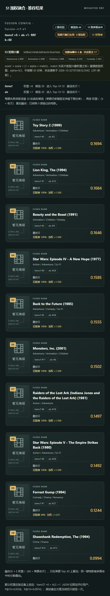
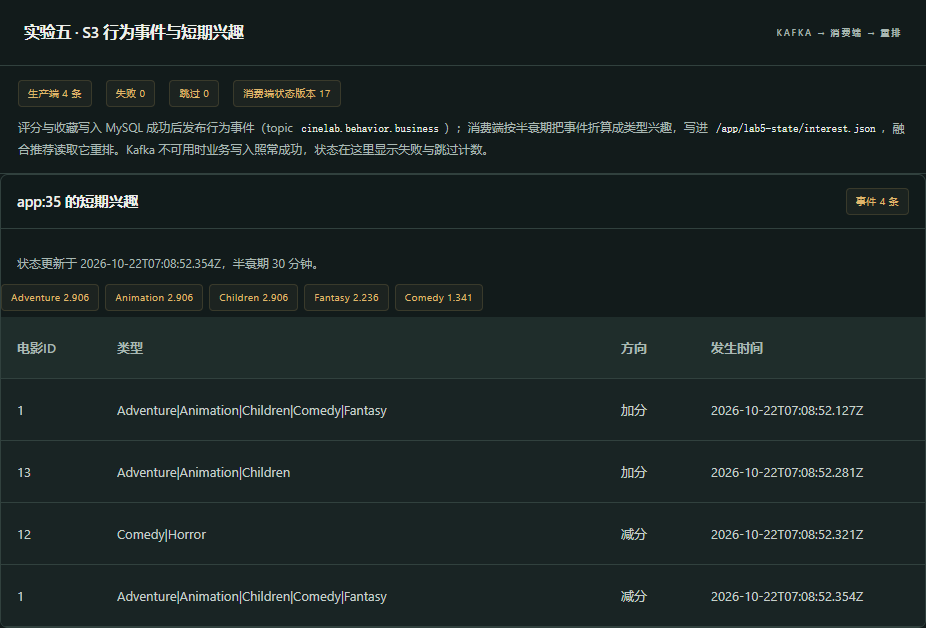
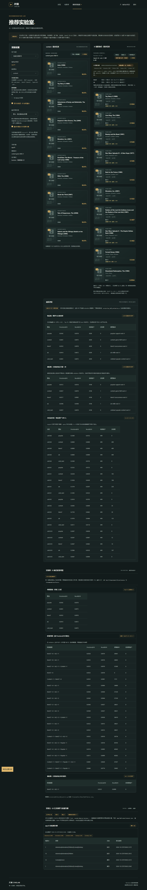

# 实验五 S3：Kafka 实时行为与短期兴趣

本文件记录实验五第二个扩展点（S3 Kafka 事件驱动）的设计、端到端联调、四类场景测试证据与前端状态反馈。
实验四已完成 **S1 加权 RRF**（见 [lab4-fusion.md](lab4-fusion.md)）；本轮做 **S3 Kafka**，并把两项扩展与基础推荐系统联调（`/me/recommendations/fusion?interest=1`）。

## 1. 目标与要求

实验五要求：实现第二项标准扩展、把两项扩展与已有推荐流程集成、完善前端交互与状态反馈、开展正常／无结果／错误输入／外部服务不可用场景测试并保留证据。
验收的关键判据是手册里的那句话——**“接收到消息不等于已实现实时推荐”**：消费者必须真的改变后续推荐结果，而不是只把消息收下来。

## 2. 链路结构

```
浏览器行为（评分/收藏）
   └─ backend/app/activity.py  写入 MySQL 后再发事件（业务成功不受 Kafka 影响）
        └─ backend/app/behavior.py  BehaviorPublisher → Kafka topic cinelab.behavior.business
             └─ scripts/run_behavior_consumer.py  消费组 lab5-short-term-interest
                  └─ reports/lab5/state/interest.json + events.jsonl（可追溯的兴趣状态）
                       └─ backend/app/interest.py  读取状态 + 类型匹配度
                            └─ backend/app/fusion.py  score' = score × (1 + alpha × match)
                                 └─ 前端 ExperimentsView 短期兴趣面板 + 融合卡片加权徽标
```

- 生产端在 API 进程内：`backend/app/behavior.py` 的 `publish_event(kind, account_id, movie_id, *, rating, genres)` 在评分/收藏事务提交后调用；Kafka 不可达时只累加失败计数并进入冷却，**不阻塞、不回滚业务写入**。
- 消费端是独立进程（不在 API 里）：`scripts/run_behavior_consumer.py`，消费组 `lab5-short-term-interest`，把每个账号的兴趣写进状态文件（原子替换），并记录事件所属 topic/partition/offset。
- 状态文件而不是新表：`docs/starter-api-4b.md` 第 65 行明确 S3 仅保留教学任务、starter 不提供额外业务表，且第 69 行规定八表 schema 冻结（唯一批准扩展是 `business.accounts.auth_version`）。因此短期兴趣落在 `reports/lab5/state/`（compose 里只读挂载进 API 容器 `/app/lab5-state`）。

## 3. 事件格式与兴趣模型

事件（`build_event` + `BehaviorPublisher.publish`，见 `backend/app/behavior.py`；Schema `cinelab-behavior-v1`，消息 key 是 `subject_key`）：

| 字段 | 含义 |
| --- | --- |
| `type` | `rating` / `favorite`（`activity.py` 在删除收藏时发 `unfavorite`） |
| `subject_key` / `account_id` | `app:<account_id>`，只服务登录账号 |
| `movie_id`、`genres` | 电影与它的管道分隔类型（生产端从目录取，不在消费端猜测） |
| `rating`、`positive` | 评分与是否 ≥ 4.0 |
| `event_id`、`schema`、`producer`、`occurred_at` | 事件号、版本、生产端标识与业务发生时间（重排按它做时间衰减） |

短期兴趣（`scripts/run_behavior_consumer.py`）：

- `rating_weight`：≥4.0 → `(rating − 3.0) / 2`（4.5 → +0.75，5.0 → +1.0）；2.5/3.0/3.5 → `0.0`（中性，只记录事件）；≤2.0 → `−(3.0 − rating) / 2`（负反馈）；收藏 `favorite` → `+1.5`，取消收藏 `unfavorite` → `−1.5`。
- 时间衰减 `decay(seconds, half_life_minutes) = 0.5 ** (seconds / (half_life × 60))`：半衰期 **30 分钟**，每来一条新事件先把该账号已有权重整体衰减到当前时刻。
- 重排（`backend/app/interest.py` 的 `rerank`）：`match = min(1, max(0, 该片类型权重之和 / 最强正权重))`；`score' = score × (1 + alpha × match)`，`alpha = 0.5`；状态超过 `max_age_seconds = 900` 视为过期（`stale=true` 时 `boost = 1.0`，不再重排）；重排后按 `(-score, movie_id 数值)` 重排名次 1..n。
- 状态里 `TOP_GENRES = 5`，前端展示前 5 个类型与权重。

## 4. 接口

| 接口 | 说明 |
| --- | --- |
| `GET /api/v1/me/behavior/interest?events=10` | 当前账号的兴趣快照（`reason` 说明为什么为空）、生产端/消费端状态、最近事件 |
| `GET /api/v1/experiments/behavior/status` | 与账号无关：topic、消费组、状态版本、offset、生产端计数器 |
| `GET /api/v1/me/recommendations/fusion?interest=1` | 融合推荐 + 短期兴趣重排；响应带 `interest` 块与每条的 `interest_match`、`interest_boost` |
| `GET /api/v1/demo/history-users/{ml_user_id}/recommendations/fusion?interest=1` | 同上（历史用户只读演示） |

`interest=0` 时响应里 `interest.enabled=false`、`interest.reason="未启用（interest=0）"`，条目不带加权，便于前后对照。
`interest` 未就绪时 `reason` 分别是“消费端还没有写出本账号的短期兴趣（先评分或收藏，再运行消费端）”或“短期兴趣状态未就绪（消费端尚未写出该账号的兴趣）”——**不伪造兴趣，也不静默套用别人的画像**。

## 5. 场景测试证据

脚本：`scripts/lab5_scenarios.py`（自管 Cookie 的 HTTP 客户端：`GET /auth/csrf` → 写请求带 `X-CSRF-Token` 与 `Origin`；注册后必须再登录一次，因为注册不建会话）。
报告：运行期落在 `reports/lab5/scenarios.json`（正常／无结果／错误输入）与 `reports/lab5/scenarios-kafka-down.json`（外部服务不可用），两者顶层 `passed=true`；随仓库提交的副本是 [lab5-scenarios.json](lab5-scenarios.json) 与 [lab5-scenarios-kafka-down.json](lab5-scenarios-kafka-down.json)（只把 `csrf_token` 脱敏，其余原样）。

### 5.1 正常场景（`app:31`，评分 1=5.0、13=4.5、12=1.0，收藏 1）

- 生产端 `sent=12, failed=0, skipped=0, state=connected`，topic `cinelab.behavior.business`。
- 消费端 `events_applied=12`，`state_version=12`，offset 证据 `{cinelab.behavior.business:1 → 4, :2 → 8}`；兴趣 `Adventure/Animation/Children 3.2442`、`Fantasy 2.4956`、`Comedy 1.4973`。
- 检查项：`events_recorded=true`、`top_genre_is_animation=true`、`horror_downweighted=true`（`Horror` 权重为负、不进 top 类型）、`interest_block_enabled=true`。
- **推荐确实改变**（同权重、同候选，只切换 `interest`）：

| | Top-10 |
| --- | --- |
| `interest=1` | 3114, 364, 595, 260, 1270, **4886, 1198, 1196**, 356, 318 |
| `interest=0` | 3114, 364, 595, 260, 1270, **356**, 4886, 1198, 1196, 318 |

被评低分的 `356`（Comedy/Drama）从第 6 位掉到第 9 位，三部高匹配影片各上前一位；`ranking_changed=true`。加权明细：`3114/364/595/260/1270/4886/1198/1196 → ×1.5`，`356 → ×1.2308`。

### 5.2 无结果场景（`app:32`，零历史）

`interest=null`、`reason` 说明消费端还没有该账号的状态、`top_genres=[]`；融合 `status=200`、`items=0`、`no_boost_on_items=true`、`no_fabricated_interest=true`。空态是显式状态，不伪造兴趣也不硬塞推荐。

### 5.3 错误输入场景

| 用例 | 期望 | 实测 |
| --- | --- | --- |
| 电影不存在 `/me/ratings/999999` | 404 | 404 `MOVIE_NOT_FOUND` |
| 评分不是半星 `/me/ratings/1` body 4.3 | 422 | 422 `VALIDATION_ERROR` |
| 评分超范围 body 6.0 | 422 | 422 `VALIDATION_ERROR` |
| 收藏不存在的电影 `/me/favorites/999999` | 404 | 404 `MOVIE_NOT_FOUND` |

`no_phantom_event=true`：四次失败写入后生产端 `sent` 没有增加——**失败请求不会发出行为事件**。

### 5.4 外部服务不可用场景（`app:34`，`docker stop cinelab-kafka-1` 后写入）

- `business_not_broken=true`：评分/收藏仍返回 200，业务不被 Kafka 拖垮。
- `failure_visible=true`：生产端 `state=cooldown`、`failed=1`、`last_error="KafkaTimeoutError: Timeout after waiting for 2.0 secs."`——失败是可观测的，不是静默丢弃。
- `recommendation_still_works=true`：融合仍返回 10 条（`interest.enabled=false` + `reason`），基础推荐不受影响。

## 6. 前端联调界面

`frontend/src/components/FusionPanel.vue` + `frontend/src/views/ExperimentsView.vue`：

- 实验设置里新增开关「融合时叠加 S3 短期兴趣」（默认开），切换后重新请求 `?interest=1|0`，页面直接呈现前后差异。
- 融合面板顶部多一枚「短期兴趣已生效 · 4 事件」徽标，下面展开 `S3 短期兴趣` 区块：来源 `kafka:cinelab.behavior.business`、消费端事件数、状态版本、top 类型权重、重排公式与 `alpha`/半衰期/状态更新时刻（含“N 秒前”）；条目徽标写成「匹配度 100% · 加权 ×1.500」。
- 页面下方新增「S3 · Kafka 行为事件与短期兴趣」面板：生产端（`sent/failed/skipped`）、消费端（状态版本、消费组、offset、状态文件）、本账号兴趣与最近事件表（含 topic/partition/offset）。





## 7. 复现命令

```powershell
# 1. 起 Kafka（叠加扩展文件；离线镜像 docker.m.daocloud.io/apache/kafka:3.9.0 已在本机）
docker compose -f compose.yaml -f deployment/lab5/compose.lab5.yaml up -d

# 2. 建主题（宿主 Python 有 kafka-python；容器内没有，所以用宿主客户端打 127.0.0.1:29092）
D:\Python311\python.exe -c "from kafka.admin import KafkaAdminClient, NewTopic; KafkaAdminClient(bootstrap_servers='127.0.0.1:29092').create_topics([NewTopic('cinelab.behavior.business', 3, 1)])"

# 3. 跑消费端（前台常驻；也可 --max-messages/--idle-timeout 跑一轮）
D:\Python311\python.exe scripts\run_behavior_consumer.py

# 4. 四类场景测试（正常/无结果/错误输入）
D:\Python311\python.exe scripts\lab5_scenarios.py
# 外部服务不可用：先 docker stop cinelab-kafka-1，跑完后 docker start
docker stop cinelab-kafka-1
D:\Python311\python.exe scripts\lab5_scenarios.py --kafka-down
docker start cinelab-kafka-1

# 5. 复核状态与接口
Get-Content reports\lab5\state\interest.json
curl.exe -s "http://127.0.0.1:8080/api/v1/experiments/behavior/status"
```

API/网页容器：`cinelab-local/api:lab5`（离线镜像 + `COPY backend recommender`）、`cinelab-local/web:lab5`，四个容器（web/api/db/kafka）healthy，入口 <http://127.0.0.1:8080>。

## 8. 边界与说明

- **不新增业务表**：短期兴趣是消费端产出的状态文件，MySQL 八表保持不变；`reports/` 不入库（`reports/lab5/state/events.jsonl`、`interest.json` 是本地证据）。
- **生产者尽力而为**：Kafka 超时 2 秒、失败进入冷却，业务写入成功与否与事件发送解耦；状态接口把 `failed/skipped/last_error` 暴露给用户，符合“不能静默伪造数据”。
- **兴趣只影响排序，不影响契约**：融合结果仍是合法 DTO（名次连续、同分按 movie_id 升序、排除已评分），S3 只是在分数上做再排序；`interest_match`/`interest_boost` 是额外可追溯字段。
- **中立与负反馈**：3.0 上下浮动记中性、≤2.0 记负权重，避免“看过就喜欢”。
- **四个基础算法未回归**：内容、ItemCF、ALS、热门榜与冷启动仍走各自 Provider（`recommender/contracts.py` 的 `PROVIDERS`），本轮只放宽各路候选深度（`MAX_RECOMMENDATIONS = 50`），默认 `limit=10` 行为不变。